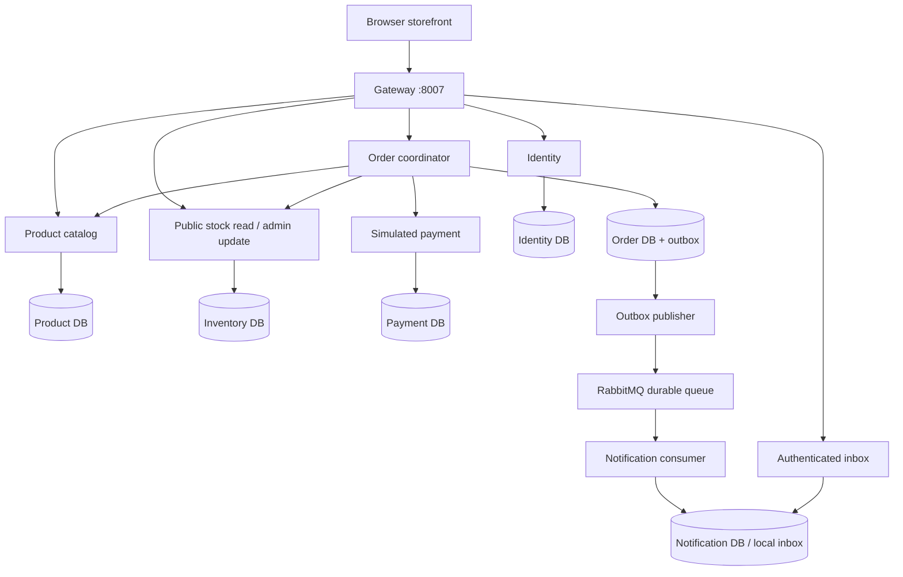

# Architecture

Implemented local architecture:

Compose exposes only the gateway, bound to host loopback. Internal APIs and
infrastructure use the private Compose network. One PostgreSQL server hosts six
databases with distinct roles/passwords. Gateway uses only a local health-schema
SQLite database; it has no business records. Workers access only their own
service's database. Native mode substitutes seven SQLite files and a local relay.

Identity owns credentials and roles; Product owns descriptive data and prices;
Inventory owns available stock and reservations; Payment owns simulated decisions;
Order owns the workflow, purchase-time price snapshots, and completed-order events;
Notification owns deduplicated local delivery records.

Shared code and image reduce build overhead but couple releases. The generic
aggregate schema is intentionally compact; typed relational domain schemas would
better support rich reporting and database-enforced domain constraints at scale.
See ADRs for tradeoffs and security documentation for deployment limits.
