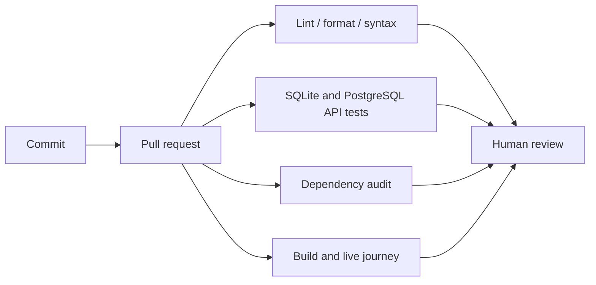

# CI and delivery

The GitHub Actions workflow runs on pushes and pull requests with read-only
repository permissions. It installs the full lock, runs Ruff lint/format checks,
SQLite tests, PostgreSQL tests in isolated schemas, JavaScript syntax validation,
and a dependency vulnerability audit. A second job builds Compose and runs the
black-box customer journey, including broker-delivered confirmation, then tears
down its disposable volumes even on failure.

Workflow code is included; no GitHub repository has been created, pushed, or
configured by this task. Branch protection and required checks must be enabled
in the chosen repository. Actions are pinned to major versions; pin reviewed
commit SHAs for stronger supply-chain reproducibility before deployment.

No ECR publication, AWS authentication, CD pipeline, Argo CD, SBOM publication,
container scanning, staging, or production approval gate is implemented yet.
Those need a destination, credentials/identity design, and cost approval where
applicable. The workflow must not be described as a deployed CI/CD system until
it has run successfully on the actual GitHub repository.
