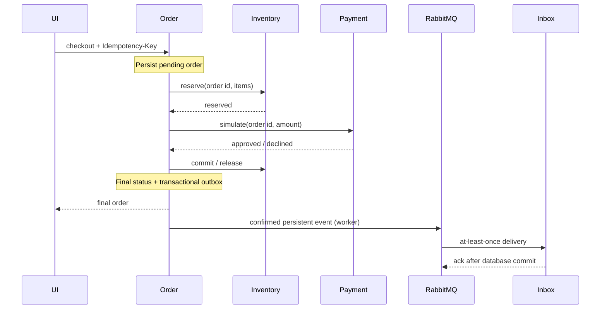

# System design

## Checkout state machine

```mermaid
stateDiagram-v2
    [*] --> pending: persist request and price snapshot
    pending --> rejected: insufficient stock
    pending --> declined: simulated decline and reservation release
    pending --> confirmed: approved payment and reservation commit
    pending --> pending: timeout / process failure; retry original key
    confirmed --> [*]
    declined --> [*]
    rejected --> [*]
```

1. Authenticate user and validate a unique list of product lines.
2. Derive order identity from user ID and Idempotency-Key.
3. Reject reuse of the key with different normalized input.
4. Retrieve authoritative prices; persist pending order with snapshots.
5. Acquire order coordination lock and reserve stock atomically.
6. Request an idempotent simulated payment by order ID.
7. Commit reservation if approved; otherwise release exactly once.
8. Commit final order state and completed-order outbox entry together.
9. Publisher sends persistent events using broker publisher confirmations.
10. Consumer commits an idempotent inbox record before acknowledging delivery.

Amounts are integer USD cents. No floating-point price calculation, taxes,
shipping, real payment providers, refunds, or cancellations are implemented.
Product price changes do not alter existing order snapshots.

## Concurrency and recovery

PostgreSQL advisory transaction locks serialize aggregate operations, including
creation of previously absent idempotency records. Conditional stock updates
prevent negative availability. Lines are sorted to reduce deadlock risk.
SQLite uses BEGIN IMMEDIATE to serialize writes per service database.

An HTTP timeout is an unknown outcome, not evidence of failure. Pending orders
are resumed using the original request and retry key. Internal reservation and
payment endpoints return the original outcome on identical retries.

There is no automatic pending-order reconciler or reservation expiry. The owner
can resume a pending order from My orders. Operators must monitor pending orders
and investigate abandoned reservations. Do not expire a reservation blindly:
payment may have succeeded while its response was lost. A real payment provider
requires query/reconciliation and refund capabilities before extending this design.

Outbox publication may duplicate messages after a crash between broker confirm
and the sent flag commit. Notification IDs make duplicate delivery harmless.
Malformed events are dead-lettered; database/broker failures trigger reconnection.
No exactly-once transport claim is made. A worker crash must be restarted by the
supervisor; worker liveness alone does not prove queue progress.

The catalog currently filters service-owned JSON aggregates in Python with
bounded output pagination; it is designed for the small demo catalog, not a
large searchable catalog. Add typed indexes and database queries before scaling.
